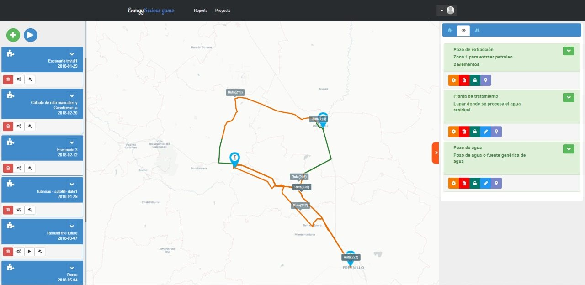
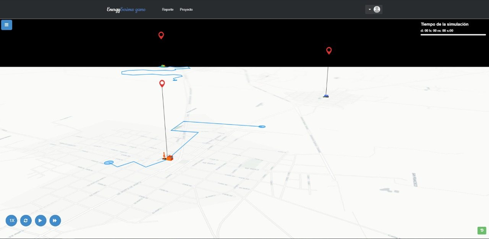
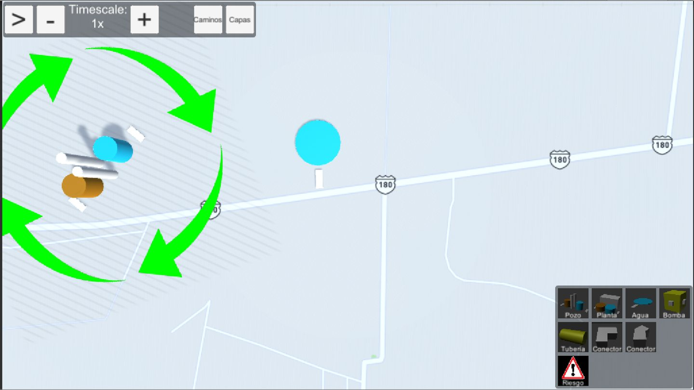
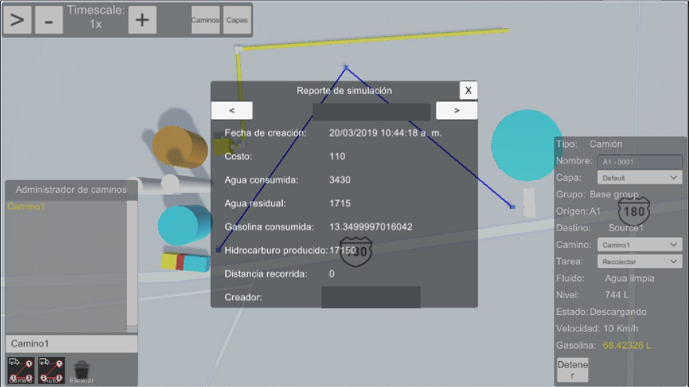
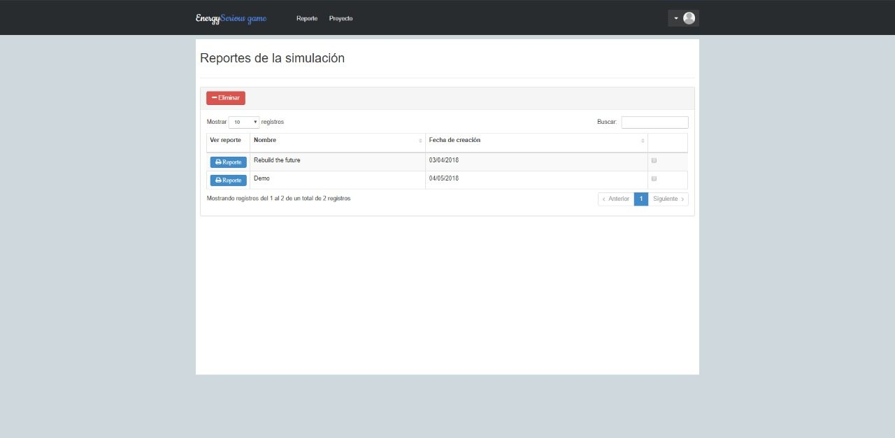
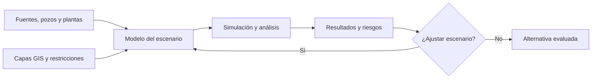

  

  
  
  
  
  

# Simulación inteligente de logística de agua para la industria energética

### Dirección de un proyecto tecnológico que integró simulación, modelado matemático, visualización 3D y análisis geoespacial para apoyar decisiones operativas.

**Plenumsoft Energy & Sustainability · Proyecto empresarial · 2018–2019 · Congreso Mexicano del Petróleo 2019**

En 2019 dirigí el desarrollo de una plataforma orientada a un problema industrial concreto: **planificar el abastecimiento y la recolección de grandes volúmenes de agua en operaciones de hidrocarburos no convencionales**. Presenté el trabajo junto con **Felipe Manuel Pacheco Rosado**, director de Plenumsoft Energy, en el Congreso Mexicano del Petróleo, celebrado en León, Guanajuato.

La propuesta reunió herramientas habituales de ingeniería industrial —modelos matemáticos, simulación de fluidos, información geográfica y evaluación de riesgos— con una experiencia de usuario inspirada en los **Serious Games**: construir un escenario, configurar activos, ejecutarlo y observar sus consecuencias.

> **Mi rol:** dirección del proyecto tecnológico, coordinación del desarrollo y presentación de resultados. Este repositorio es un **caso de estudio de una plataforma empresarial histórica**; no publica su código propietario ni implica que el producto continúe disponible.

## El reto

En la logística del agua para yacimientos de lutitas intervienen fuentes de suministro, pozos, vehículos cisterna, tuberías y plantas de tratamiento. La disponibilidad de agua, los puntos de recolección y las condiciones de transporte pueden cambiar con el tiempo.

No bastaba con dibujar una ruta en un mapa: debíamos representar **recursos con restricciones**, estimar sus efectos sobre la operación y permitir analizar alternativas de **menor costo, menor riesgo o un equilibrio entre ambos**.

## Lo que construimos

Una **plataforma multiusuario y multiplataforma (web/escritorio)** para crear y simular escenarios logísticos, combinando:

| Capacidad | Qué aportaba al usuario |
| :--- | :--- |
| **Constructor de escenarios** | Posicionar pozos, fuentes de agua, plantas, vehículos y tuberías en un lienzo geográfico |
| **Información geoespacial (GIS)** | Integrar carreteras, caminos, poblaciones y otras capas relevantes para el análisis |
| **Rutas y recursos** | Configurar rutas, capacidad de pipas, combustible y condiciones operativas |
| **Simulación de fluidos** | Estimar flujo y pérdidas de presión en redes de tuberías mediante un motor físico |
| **Análisis de riesgo** | Incorporar variables socioambientales y modelos de inferencia en la evaluación de escenarios |
| **Optimización** | Explorar alternativas de distribución bajo criterios de costo y riesgo |
| **Reportes** | Consultar indicadores de las ejecuciones y revisar o ajustar escenarios |

La propuesta contemplaba también el estándar de datos **PPDM** para organizar información del sector petrolero. El documento técnico lo describe como parte del diseño; no se afirma aquí una certificación de conformidad con PPDM.

## Tecnologías y enfoques

**WebGL** para la visualización interactiva 3D, **Python** como parte de las tecnologías empleadas en el desarrollo, integración **GIS**, modelos matemáticos de transporte, simulación física, técnicas de optimización y diseño de interacción bajo la filosofía **Serious Games**.

El trabajo presentado en 2019 también describe modelos gráficos probabilísticos, algoritmos genéticos y sistemas de recomendación para el análisis de rutas y riesgos. La documentación compartida no identifica el framework específico de WebGL ni permite atribuir cada módulo a una tecnología concreta; por ello evitamos inventar un stack detallado.

## La plataforma en funcionamiento

### Diseñar y configurar escenarios

Los operadores podían añadir elementos al escenario, relacionarlos mediante rutas y modificar parámetros antes de ejecutar la simulación.

### Explorar el entorno tridimensional

La visualización interactiva permitía recorrer trayectorias y observar el escenario en un entorno tridimensional.

### Modelar recursos y restricciones

La simulación consideraba características de vehículos y componentes de la red, como capacidad de transporte, combustible y propiedades del sistema hidráulico.

### Ejecutar y analizar resultados

Las ejecuciones podían producir valores sobre **costos, agua consumida y residual, combustible, producción y recorridos**, entre otros indicadores del modelo.

El sistema incluía consulta de reportes para apoyar la revisión de resultados y la iteración de escenarios.

## De la hipótesis al análisis

## Mi contribución y los resultados

Como **director del proyecto**, mi responsabilidad fue conducir el desarrollo de una solución que reunía disciplinas y componentes diversos, articulando el problema operativo con una plataforma utilizable y con capacidad de presentación técnica.

El resultado documentado fue un sistema con interfaces de construcción de escenarios, simulación web/escritorio y reportes; la investigación y la plataforma se **presentaron en el Congreso Mexicano del Petróleo 2019**. No se publican porcentajes de ahorro ni afirmaciones de impacto comercial que no estén sustentadas por evidencias disponibles.

## 📚 Referencias y alcance

- **Trabajo técnico:** *Método para la simulación de la logística del traslado de agua en yacimientos de hidrocarburos en lutitas*, presentado en el Congreso Mexicano del Petróleo, León, Guanajuato, junio de 2019.
- **Autores del trabajo:** Felipe Manuel Pacheco Rosado y Yahvé Isaías Solís Aranda.
- [Detalle técnico, atribución y alcance del caso](docs/scope-and-evidence.md).

Las capturas proceden del material histórico de difusión del proyecto. El software, sus diseños y las marcas pertenecen a sus respectivos titulares; no se distribuyen fuentes ni activos internos del producto bajo una licencia abierta.

---

<strong>Ingeniería, simulación y experiencia interactiva al servicio de decisiones industriales complejas.</strong>

Caso de estudio profesional de <a href="https://github.com/isaiassolis">Isaías Solís</a>

