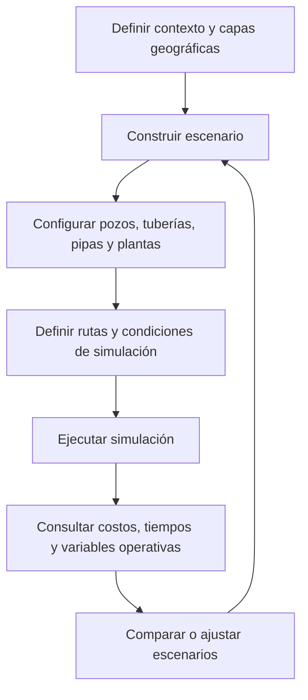

  

  
  
  
  

# Simulación de logística de agua en yacimientos de hidrocarburos

**Caso de estudio empresarial histórico (2019)** · Plenumsoft Energy & Sustainability · Congreso Mexicano del Petróleo, León, Guanajuato.

**Rol:** Dirección del proyecto tecnológico, según declaración de Isaías Solís; coautor y expositor de la presentación junto con el director de Plenumsoft Energy.

> **Portafolio documental, no publicación del producto:** aquí se muestran capacidades y resultados descritos en material de congreso de 2019. No se comparte código, datos operativos, infraestructura ni propiedad intelectual de la empresa. Las capturas son material histórico y **no constituyen demostración de un sistema disponible hoy**.

## 🎯 El problema

El traslado y la recolección de agua para la explotación de hidrocarburos no convencionales implican asignar recursos, ubicar pozos y plantas, seleccionar rutas y evaluar restricciones logísticas y ambientales. La propuesta documentada buscó integrar esas decisiones en una plataforma de simulación que facilitara comparar escenarios.

## 🧩 La solución presentada

Se reportó una **plataforma web y de escritorio** que permitía modelar escenarios de abastecimiento y recolección de agua, configurar recursos logísticos, incorporar capas GIS y ejecutar simulaciones con resultados de costo, tiempo y variables operativas.

| Componente | Función documentada |
| :--- | :--- |
| **Editor de escenarios** | Colocar pozos, vehículos, tuberías y plantas de tratamiento |
| **Capas GIS** | Incorporar información geográfica y rutas |
| **Motor de rutas** | Calcular recorridos de abastecimiento y recolección |
| **Simulación física** | Estimar flujo de agua y pérdidas en tuberías |
| **Modelos probabilísticos** | Analizar factores de riesgo socioambiental |
| **Optimización** | Aplicar algoritmos genéticos y sistemas de recomendación a rutas y escenarios, según la presentación |
| **Interfaz interactiva** | Facilitar la construcción y exploración visual bajo un enfoque de *Serious Games* |

**Nota:** se describen las capacidades presentadas en 2019; no todas cuentan con benchmarks o verificaciones independientes en este repositorio.

## 🔄 Flujo de trabajo

## 🖥️ Evidencia visual del proyecto

### 1. Construcción de escenarios

Interfaz histórica de definición de escenarios, ubicación de recursos y trazado de rutas sobre un mapa.

### 2. Simulación geoespacial

Visualización de trayectorias y elementos dentro del escenario tridimensional.

### 3. Configuración de recursos

Herramientas de inserción y configuración de recursos, con componentes para pozos, tuberías y elementos de riesgo.

### 4. Resultados de simulación

Captura histórica de un reporte de simulación con variables como costo, agua consumida, agua residual y combustible. Se ocultaron etiquetas identificadoras de la prueba y del creador.

### 5. Administración de reportes

Interfaz que muestra reportes guardados y su consulta posterior.

## 👤 Dirección del proyecto y comunicación técnica

La responsabilidad de **dirección del proyecto** fue comunicada por Isaías Solís para este caso de estudio. La presentación del Congreso Mexicano del Petróleo de junio de 2019 lo acredita como coautor de la exposición junto con el Ing. Felipe Pacheco Rosado.

La experiencia ilustra la coordinación de una solución que reunía logística industrial, simulación, información geográfica, modelos computacionales y experiencia de usuario. **No atribuimos la programación de todos los módulos a una sola persona**.

## 📌 Resultados y límites de la evidencia

La presentación de 2019 indica que se obtuvo una plataforma con capacidades web/escritorio y un modelo matemático implementado para simular transporte de agua. También muestra escenarios, reportes y controles de simulación. **No tenemos información suficiente para cuantificar ahorros financieros o de tiempo, ni para confirmar el estado actual del producto.**

Consultar [alcance, fuentes y consideraciones de publicación](docs/scope-and-evidence.md).

## 🔒 Aviso de propiedad intelectual

Este repositorio contiene únicamente una descripción de la experiencia y capturas históricas seleccionadas, provenientes del material presentado públicamente en congresos según el responsable del caso. **Las marcas, los diseños y el software pertenecen a sus respectivos titulares.** El repositorio no concede licencias sobre código o contenido de terceros.

---

<strong>De la complejidad logística a escenarios que ayudan a tomar decisiones.</strong>

Caso de estudio presentado por <a href="https://github.com/isaiassolis">Isaías Solís</a>

