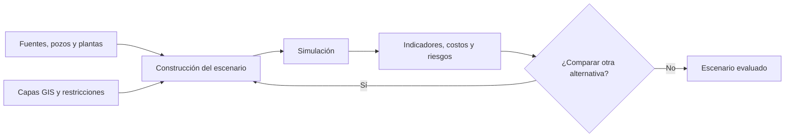

  

  
  
  
  
  

# Simulación inteligente de logística de agua para la industria energética

**Dirección de proyecto tecnológico · Simulación industrial · Información geoespacial · Visualización 3D**

Durante mi etapa en **Plenumsoft Energy & Sustainability**, dirigí el desarrollo de una plataforma de simulación para apoyar la planificación del abastecimiento y la recolección de agua en operaciones de hidrocarburos no convencionales.

Nuestro trabajo combinó **modelado matemático, simulación física, información geográfica (GIS) y visualización interactiva**. Diseñamos una experiencia inspirada en los **Serious Games**, con la que los usuarios podían construir escenarios, configurar recursos, ejecutar simulaciones y analizar resultados.

En junio de **2019**, presenté el proyecto junto con **Felipe Manuel Pacheco Rosado** en el **Congreso Mexicano del Petróleo**, celebrado en León, Guanajuato. Ambos participamos como autores del trabajo técnico.

## El desafío

La logística del agua en yacimientos de lutitas requiere coordinar fuentes de suministro, pozos, vehículos cisterna, redes de tuberías y puntos de tratamiento o recolección. Cada decisión depende de restricciones de capacidad, condiciones geográficas, disponibilidad de recursos, costos y riesgos.

El objetivo era ir más allá de trazar rutas: necesitábamos una herramienta para **representar las condiciones de la operación y comparar alternativas antes de tomar decisiones**.

## La plataforma

Dirigí el desarrollo de una plataforma **web y de escritorio**, concebida para trabajar con escenarios logísticos desde un entorno visual.

| Componente | Funcionalidad |
| :--- | :--- |
| **Constructor de escenarios** | Ubicación y configuración de pozos, fuentes de agua, plantas, vehículos y tuberías. |
| **Información geográfica (GIS)** | Consulta de capas territoriales, carreteras, caminos y elementos relevantes para la operación. |
| **Rutas y recursos** | Definición de trayectorias, capacidades de transporte, combustible y parámetros operativos. |
| **Simulación física** | Modelado de flujo de agua y pérdidas de presión en redes de tuberías. |
| **Riesgos** | Análisis de condiciones socioambientales y escenarios de incertidumbre. |
| **Evaluación de alternativas** | Comparación de opciones desde criterios de costo y riesgo. |
| **Resultados y reportes** | Consulta de indicadores y revisión de ejecuciones para ajustar los escenarios. |

## La plataforma en imágenes

### Construcción de escenarios

*Configuración visual de los elementos que intervienen en la operación.*

### Visualización tridimensional

*Exploración del entorno y las trayectorias desde una vista 3D.*

### Configuración de recursos

*Definición de activos, vehículos y características de la operación.*

### Simulación y resultados

*Análisis de indicadores como consumo de recursos, recorridos y costos estimados.*

### Reportes

*Consulta de información para comparar y revisar escenarios.*

## Tecnologías y enfoques

Durante el proyecto utilizamos **WebGL y Python**, junto con tecnologías de información geográfica y modelos matemáticos para representar el transporte de agua y el comportamiento de los recursos.

El enfoque técnico incluyó:

- **GIS y visualización 3D** para trabajar con el territorio y sus activos.
- **Simulación de fluidos** para analizar redes y condiciones hidráulicas.
- **Modelado probabilístico** para abordar incertidumbre y riesgos.
- **Optimización** para estudiar distintas alternativas operativas.
- **Serious Games** como referencia para la interacción visual con escenarios complejos.

El trabajo de investigación también contempló algoritmos genéticos, sistemas de recomendación y el modelo de datos **PPDM** como parte del diseño tecnológico.

## Cómo funcionaba

## Mi participación

Como **director del proyecto tecnológico**, coordiné el desarrollo de una solución multidisciplinaria que integró ingeniería de software, modelado matemático, información geográfica y visualización.

Mi responsabilidad fue conducir el trabajo del equipo y articular los diferentes componentes técnicos alrededor de una experiencia que permitiera a los usuarios **construir escenarios y analizar decisiones operativas**.

También participé en la **presentación del proyecto y sus resultados** en el Congreso Mexicano del Petróleo 2019.

## Resultados y presentación

El desarrollo dio lugar a una plataforma con herramientas de construcción de escenarios, configuración de recursos, simulación, visualización tridimensional y reportes.

Presentamos el trabajo **«Método para la simulación de la logística del traslado de agua en yacimientos de hidrocarburos en lutitas»** en el **Congreso Mexicano del Petróleo 2019**.

**Autores:** Felipe Manuel Pacheco Rosado y Yahvé Isaías Solís Aranda.

## Sobre el proyecto

Este desarrollo formó parte del trabajo tecnológico de **Plenumsoft Energy & Sustainability**. Las imágenes muestran vistas de la plataforma utilizada para las presentaciones de la época. El repositorio recoge mi experiencia profesional sin distribuir el código fuente ni información interna del producto.

[Conocer más sobre el desarrollo y mi participación](docs/scope-and-evidence.md).

---

<strong>Dirección de proyectos · Ingeniería industrial · Simulación · Tecnología geoespacial</strong>

<a href="https://github.com/isaiassolis">Volver a mi portafolio profesional</a>

